<div align="center">



<a href="https://git.io/typing-svg">
  
</a>

<p>
  
  <a href="https://github.com/mariafuquene?tab=followers"></a>
</p>

</div>

---

## 👩‍💻 Sobre mí

```js
const maria = {
  nombre: "María Camila Fúquene Galvis",
  rol: "Frontend Developer",
  stack: ["HTML", "CSS", "JavaScript", "React"],
  aprendiendo: ["TypeScript", "Testing", "Accesibilidad web"],
  pasion: "Crear experiencias web bonitas, accesibles e interactivas",
  saludar() {
    return `¡Gracias por visitar mi perfil! 💜`;
  },
};
```

## 🛠️ Tecnologías

<div align="center">

<a href="https://developer.mozilla.org/es/docs/Web/HTML"></a>&nbsp;
<a href="https://developer.mozilla.org/es/docs/Web/CSS"></a>&nbsp;
<a href="https://developer.mozilla.org/es/docs/Web/JavaScript"></a>&nbsp;
<a href="https://react.dev/"></a>

<sub>Herramientas</sub><br/>


</div>

## 🎯 ¿Qué sé hacer? <sub><sup>(haz clic en cada sección)</sup></sub>

<details>
<summary><b>🧱 HTML — estructura semántica y accesible</b></summary>
<br/>

- Etiquetas semánticas (`header`, `main`, `section`, `article`, `nav`, `footer`)
- Formularios con validación nativa
- Accesibilidad: atributos `aria-*`, `alt`, jerarquía de encabezados
- SEO básico con metaetiquetas

```html
<main>
  <section aria-labelledby="proyectos">
    <h2 id="proyectos">Mis proyectos</h2>
    <article class="card">
      
      <h3>Mi proyecto</h3>
    </article>
  </section>
</main>
```
</details>

<details>
<summary><b>🎨 CSS — diseño responsive y animaciones</b></summary>
<br/>

- Flexbox y CSS Grid
- Diseño responsive con *media queries* y unidades relativas
- Variables CSS, transiciones y `@keyframes`
- El banner animado de este perfil está hecho **solo con SVG + CSS** ([ver código](./assets/header.svg))

```css
:root { --primario: #7f5af0; }

.card {
  display: grid;
  gap: 1rem;
  border-radius: 1rem;
  transition: transform .3s ease, box-shadow .3s ease;
}

.card:hover {
  transform: translateY(-6px);
  box-shadow: 0 12px 24px rgb(127 90 240 / .3);
}
```
</details>

<details>
<summary><b>⚡ JavaScript — lógica e interactividad</b></summary>
<br/>

- ES6+: *arrow functions*, desestructuración, *spread*, módulos
- Manipulación del DOM y eventos
- Asincronía con `Promise`, `async/await` y `fetch`
- Métodos de arreglos: `map`, `filter`, `reduce`

```js
const obtenerRepos = async (usuario) => {
  const res = await fetch(`https://api.github.com/users/${usuario}/repos`);
  const repos = await res.json();
  return repos
    .filter(({ fork }) => !fork)
    .map(({ name, stargazers_count }) => ({ name, estrellas: stargazers_count }));
};
```
</details>

<details>
<summary><b>⚛️ React — componentes y estado</b></summary>
<br/>

- Componentes funcionales y JSX
- Hooks: `useState`, `useEffect`, `useContext`, hooks personalizados
- Props, renderizado condicional y listas
- Proyectos con Vite

```jsx
import { useState } from "react";

export default function Saludo() {
  const [likes, setLikes] = useState(0);

  return (
    <button onClick={() => setLikes(likes + 1)}>
      💜 Me gusta este perfil: {likes}
    </button>
  );
}
```
</details>

## 📊 Estadísticas

<div align="center">


</div>

## 🐍 Mis contribuciones

<div align="center">
<picture>
  <source media="(prefers-color-scheme: dark)" srcset="https://raw.githubusercontent.com/mariafuquene/mariafuquene/output/github-snake-dark.svg"/>
  
</picture>
</div>

## 🤝 Conectemos

<div align="center">

<a href="https://github.com/mariafuquene"></a>
<!-- Descomenta y completa con tu usuario de LinkedIn:
<a href="https://www.linkedin.com/in/TU-USUARIO/"></a>
-->


</div>
