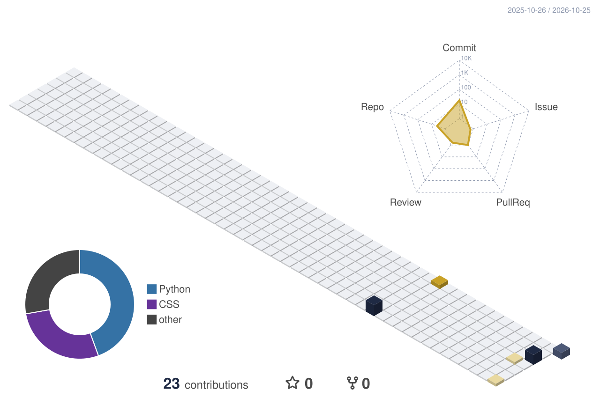

<!-- ═══════════════ BANNER ═══════════════ -->

 

<!-- ═══════════════ WHO I AM ═══════════════ -->

  

 

<!-- ═══════════════ TIMELINE ═══════════════ -->

  

 

<!-- ═══════════════ TECH STACK ═══════════════ -->

### ✦ Tech stack 🌱 currently learning

### ✦ Ops toolkit

 

<!-- ═══════════════ GITHUB GRAPHS ═══════════════ -->

### ✦ GitHub in motion

 

<!-- ═══════════════ 3D CONTRIBUTIONS ═══════════════ -->

  

<!-- ═══════════════ SNAKE ═══════════════ -->

<picture>
  <source media="(prefers-color-scheme: dark)" srcset="https://raw.githubusercontent.com/mariafuquene/mariafuquene/output/github-snake-dark.svg"/>
  <source media="(prefers-color-scheme: light)" srcset="https://raw.githubusercontent.com/mariafuquene/mariafuquene/output/github-snake.svg"/>
  
</picture>

 

<!-- ═══════════════ RIGHT NOW ═══════════════ -->

### ✦ Right now

 &nbsp;Studying **Systems Engineering** 
 &nbsp;Practicing **Python & web** 
 &nbsp;Uploading my **first projects** here

 

<!-- ═══════════════ ESPAÑOL ═══════════════ -->

<b>🌎 Leer en español</b>

 

**Operaciones en tiempo real · Calidad de datos · Estudiante de Ingeniería de Sistemas**

🤖 **Robots y tecnología** — Monitoreo robots de entrega autónomos en tiempo real 
⚽🏀 **Deportes y datos** — Lidero operaciones de datos en vivo de fútbol y NBA para modelos de visión con IA 
🎙️ **Comunicación y creatividad** — Periodista de formación: contenido, fotografía, storytelling

**Trayectoria:** 2015 Sanitas (Comunicaciones) → 2016 Bottero (Community Manager) → 2020–2025 Amazon (Atención al cliente y QA) → 2025 Genius Sports (Match Lead) → 2025 Emapta (Operadora de robots) → Hoy: Ingeniería de Sistemas 🎓

**Aprendiendo:** Python · HTML · CSS · JavaScript · Git

**Ahora mismo:** 🎓 estudio Ingeniería de Sistemas · 💻 practico Python y web · 🌱 subo aquí mis primeros proyectos

_De operar la tecnología a construirla._

 

<!-- ═══════════════ CLOSING ═══════════════ -->

